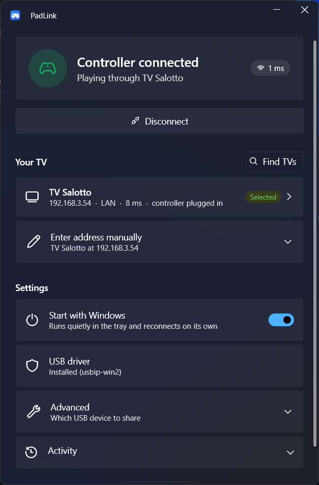
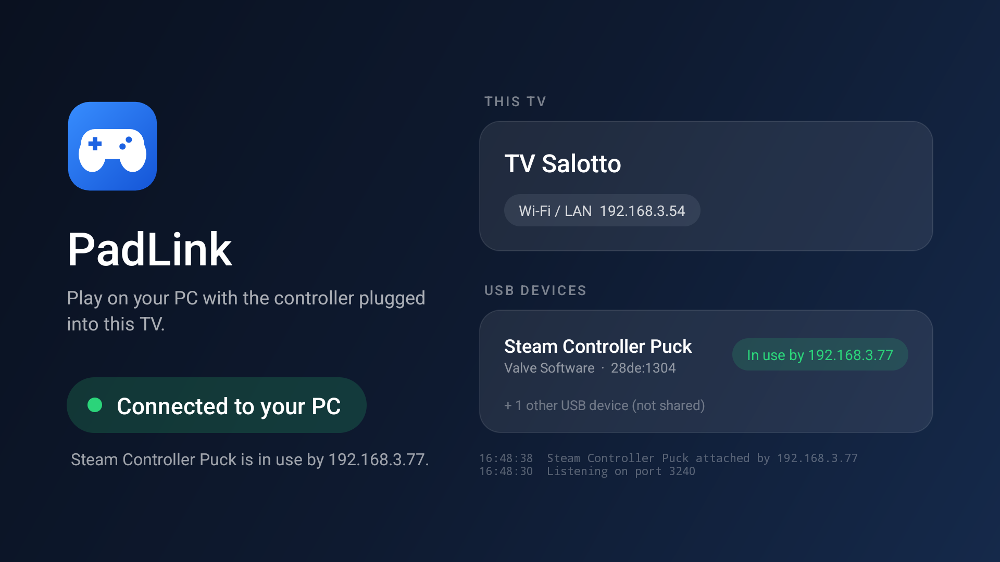

# PadLink

A tiny VirtualHere-style tool. A Steam Controller plugged into an **Android TV** shows up on a **Windows PC** as a real USB device, on the same LAN or across the internet.

```
Steam Controller --USB--> Android TV (PadLink, USB/IP server :3240) ==TCP==> Windows (usbip-win2) --> Steam
```

PadLink passes raw USB through (the USB/IP protocol), so Steam sees the genuine Valve device. Trackpads, gyro, haptics and Steam Input all behave as if the controller were plugged into the PC.

| Windows app | TV app |
|---|---|
|  |  |

The Windows app's icon can be regenerated with `windows/tools/make-icon.ps1`.

## 1. Build and install on the TV

1. Open this folder in **Android Studio** (it creates the Gradle wrapper and SDK the first time), then run **Build > Build APK(s)**.
2. On the TV, turn on Developer options and USB/Network debugging, then from the PC run:
   ```
   adb connect <tv-ip>:5555
   adb install app/build/outputs/apk/debug/app-debug.apk
   ```
3. Plug the controller (or its wireless puck) into the TV. Android asks to open PadLink: tick **"Always"** and press OK.
4. The PadLink screen lists the TV's IPs, the shared device with its **bus id** (e.g. `1-3`), and the exact attach command.

PadLink runs as a foreground service with a low-latency Wi-Fi lock. It keeps running after you leave the app. Use wired Ethernet on the TV if you can.

## 2. Windows side

1. Install **usbip-win2** from <https://github.com/vadimgrn/usbip-win2/releases>. Its driver is signed, so no test mode is needed.
2. In a terminal:
   ```
   usbip list -r <tv-ip>
   usbip attach -r <tv-ip> -b <busid>
   ```
3. Windows plays the "device connected" sound, and Steam picks up the controller.
4. To release it: `usbip port`, then `usbip detach -p <port>`.

Only one PC can attach the device at a time.

### Easiest: the PadLink tray app (`windows/PadLinkTray`)

This is a small native C# / WinForms app that sits in the system tray:

- Enter the TV address once (LAN IP or Tailscale `100.x`). It finds the controller and attaches it, then re-attaches after drops, reboots and replugs.
- The tray icon shows the state: green = connected, yellow = waiting, red = error, grey = off.
- The window shows the live round-trip time to the TV and the input lag it adds.
- It has a "Start with Windows" option, a Detach button and an Exit button. Exit detaches the controller.

To build it, install the .NET 8 SDK (`winget install Microsoft.DotNet.SDK.8`), then:

```
cd windows\PadLinkTray
dotnet publish -c Release -r win-x64 --self-contained -p:PublishSingleFile=true -p:IncludeNativeLibrariesForSelfExtract=true -p:EnableCompressionInSingleFile=true -p:DebugType=none -o publish
```

The result is `publish\PadLink.exe`, about 68 MB and runnable on any Windows PC. For a 0.2 MB exe on PCs that have the .NET 8 Desktop Runtime installed, add `--self-contained false` instead and drop the compression flags. usbip-win2 must still be installed: PadLink drives its `usbip.exe`.

### Alternative: the auto-attach script

`windows/padlink.ps1` does the above for you. It finds the Valve device on the TV and attaches it. It re-attaches every time the connection drops or the controller is replugged, and detaches on Ctrl+C:

```
powershell -ExecutionPolicy Bypass -File windows\padlink.ps1 -TvHost <tv-ip>
```

To use it for a different device, pass `-Vendor <hex vendor id>`.

## 3. Over the internet

USB/IP has **no encryption and no password**. Never port-forward 3240 on your router. Use **Tailscale** instead (free, peer-to-peer, encrypted, no router setup):

1. Install Tailscale on the Android TV (Play Store) and on the Windows PC, and sign in to the same account on both.
2. The PadLink screen shows the TV's `100.x.y.z` Tailscale address. Use it in place of `<tv-ip>`:
   ```
   usbip attach -r 100.x.y.z -b <busid>
   ```
3. Run `tailscale ping <tv-name>` on the PC. You want to see `via direct`, not `via DERP` (a relay, which adds a lot of lag).

For safety, PadLink only accepts connections from LAN, Tailscale and IPv6-ULA addresses. To change that, edit `ALLOW_PUBLIC_CLIENTS` in `UsbIp.kt`.

### About lag

Bandwidth is irrelevant: the controller sends well under 100 KB/s. The only factor is **ping** between the two places. Each input report costs about half a round trip, plus about 1 ms of overhead. So 10 ms ping ≈ 5–6 ms of added input lag, and 40 ms ping ≈ 20 ms.

## Limitations

- No isochronous transfers (audio/webcam devices). HID devices such as controllers, keyboards and mice are fine.
- Link speed is guessed (full vs high speed) from endpoint sizes.
- Bus ids change when the device is replugged. Check the TV screen.
